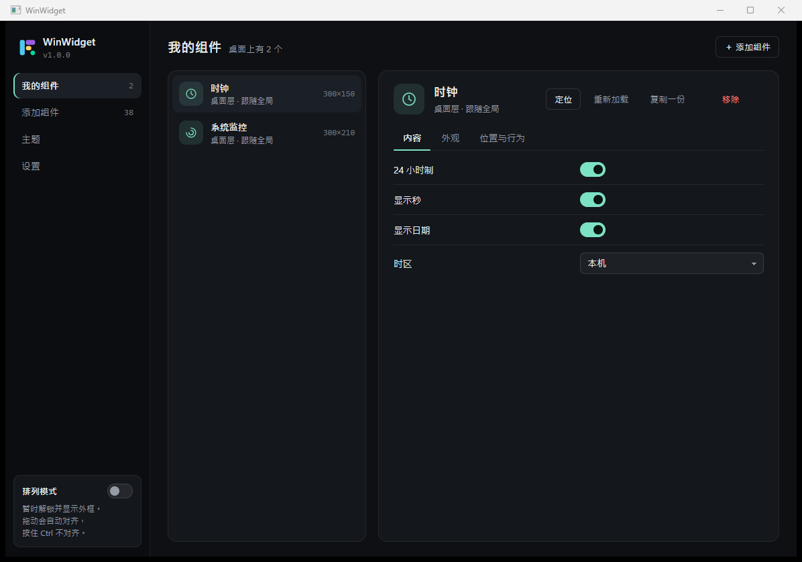
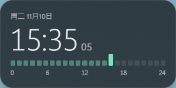
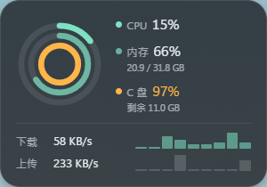
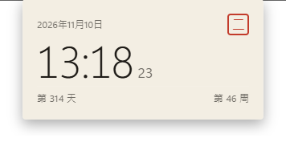

# WinWidget

用 Rust 重写的 Windows 桌面组件（desktop widget）工具，功能对齐原 C# / .NET 9 版 FullWidget：每张卡片是一个无边框透明窗口 + 独立 WebView2 页面，组件本身就用普通的 **HTML + CSS + JavaScript** 写，主题和外观在控制中心里调。



| 时钟卡片（instrument 主题） | 系统监控卡片 |
| --- | --- |
|  |  |

把全局主题切成 `paper` 后，同一张时钟卡片连内容编排都换了（纯读数改成月历式排版）：



## 功能

- **38 个内置组件**：clock、analogclock、flipclock、worldclock、calendar、countdown、pomodoro、timer、progress、weather、forecast、airquality、sunmoon、sysinfo、usage、netspeed、disks、battery、network、pcinfo、recyclebin、volume、power、notes、todo、launcher、habits、calculator、search、infocard、rss、currency、dailyimage、onthisday、media、photoframe、whitenoise、label。
- **三种层级**：桌面层（贴在壁纸上、Win+D 不会被带走）、置顶（总在最前）、普通；可锁定位置、可鼠标穿透、可按比例缩放、可吸附对齐。
- **外观逐卡可调**：透明 / 磨砂（DWM 亚克力）、阴影、背景色与不透明度、文字色、强调色（可取 Windows 系统色）、字体、字号比例、圆角、内边距、整卡透明度、自定义 CSS。
- **三套主题**：`instrument`（深色仪器）、`paper`（浅色纸张）、`type`（排印风），主题切换即时生效，单张卡片也可单独指定主题。
- **控制中心**：我的组件、添加组件（38 个内置 + 用户组件，带预览图与分类筛选）、主题、设置（通用 / 热键 / 更新 / 数据目录 / 文件关联 / 低资源模式 / 开发者模式 / 自动更新 / 开机自启 / 全屏自动隐藏）。
- **托盘与热键**：手写 Win32 托盘图标（无第三方依赖），左键唤出控制中心，右键菜单可切换"隐藏全部卡片"、逐卡操作与主题；默认热键 `Ctrl+Alt+W`（控制中心）、`Ctrl+Alt+N`（便签）。
- **单实例**：第二次启动不会起两个进程，而是把已在运行的实例的控制中心唤到前台。
- **组件包（`.fwz`）**：支持拖拽到控制中心安装、导出、卸载，注册 `HKCU\Software\Classes\.fwz` 后双击即可安装。
- **权限模型**：组件在 `widget.json` 里声明所需能力（文件、媒体、系统信息、音频等），首次使用时由控制中心授权，未授权的能力调用直接失败。
- **开发者模式**：改完组件文件保存即热重载，页面上自动重载 + 保留组件状态；同时打开 WebView2 devtools。
- **低资源模式**：给 WebView2 追加 `--disable-gpu --disable-gpu-compositing` 等参数，降低显存与 CPU 占用。
- **全屏自动隐藏**：用 Windows 自己的 `SHQueryUserNotificationState` 判断是否有全屏应用/演示在跑，全屏时收起全部卡片。
- **每卡独立存储**：`widget.storage` 落到 `%APPDATA%\WinWidget\storage`，单卡上限 2 MB。
- **组件市场 / 自动更新**：都走可配置的 URL（`market_url`、`update_url`），未配置时对应入口给出明确提示。
- **命令行**：`winwidget list | add <id> | remove <id> | --version`，会与运行中的副本抢配置的写操作会被拒绝而不是偷偷写。

## 技术栈

| 部分 | 选型 |
| --- | --- |
| 窗口 / 事件循环 | `tao` 0.35 |
| WebView2 宿主 | `wry` 0.57（透明 WebView、IPC、devtools、拖拽） |
| 页面服务 | `tiny_http`（本地回环 HTTP，按 `Host` 路由到不同组件，端口随机） |
| Windows 原生 | `windows` 0.61 + 手写 `extern "system"` 绑定（托盘 `Shell_NotifyIconW`、DWM 亚克力、桌面层 `SetParent(Progman)`、回收站 `SHFileOperationW`、电源、音频） |
| 系统信息 | `sysinfo` 0.40 |
| 其它 | `serde`/`serde_json`、`notify`（文件监听）、`zip`（`.fwz` 打包）、`ureq`（市场/更新下载）、`image`、`rfd`（文件对话框）、`winreg`（自启动与文件关联） |

## 目录结构

```
WinWidget/
├─ Cargo.toml
├─ assets/                    # 与宿主解耦的前端资产（可直接改、可直接发版）
│  ├─ widgets/                # 38 个内置组件，每个一个文件夹
│  ├─ sdk/                    # base.css、widget-sdk.js、widget.d.ts、three themes/
│  ├─ ui/control-center/      # 控制中心页面（index.html / style.css / app.js / i18n.js）
│  ├─ ui/docs/                # 内置文档页
│  ├─ templates/              # "新建组件"用的模板
│  └─ docs/                   # 组件开发指南、市场说明、里程碑说明
├─ src/
│  ├─ main.rs                 # 纯入口：单实例、事件循环、CLI；逻辑都在 lib.rs 里
│  ├─ lib.rs                  # 库入口，把下面几层按依赖顺序曝光
│  ├─ core/                   # 地基：paths / config / storage / logging / text / net / img / util
│  ├─ model/                  # 磁盘上的描述与校验：manifest / catalog / categories / themes /
│  │                          #   appearance / permissions / icons
│  ├─ market/                 # 分发：packages(.fwz) / client(市场) / updater
│  ├─ runtime/                # 唯一持有窗口与事件循环的一层：app / window / bridge / snap / shim / monitor
│  ├─ ui/                     # 用户动作的入口面：control(控制中心 API) / menus / server(本地 HTTP)
│  └─ platform/               # 与 Windows 打交道：win32 / tray / shell / sysinfo / audio / media / files / power
└─ docs/screenshots/          # 本文用到的实机截图
```

## 构建与运行

需要 MSVC 工具链（Rust `stable-x86_64-pc-windows-msvc`）和系统里的 **WebView2 Runtime**（Win10 1803+ / Win11 一般已自带）。

```powershell
cargo build            # 调试版：target\debug\winwidget.exe
cargo build --release  # 发布版：target\release\winwidget.exe（opt-level="s" + LTO + strip）
cargo run
```

首次启动会自动建两张示例卡片（时钟 + 系统监控），打开控制中心，并写入 `%APPDATA%\WinWidget\config.json`。

命令行（适合脚本）：

```powershell
winwidget --version
winwidget list                 # 当前卡片 + 全部可用组件
winwidget add winwidget.notes  # 在桌面上放一张便签（需先退出正在运行的实例）
winwidget remove <instance-id>
```

## 打包与发布

脚本都在 `scripts/`，本地跑的就是 CI 跑的那几个：

```powershell
pwsh -File scripts/run.ps1                        # 构建（调试）并启动；-Kill 先结束旧实例，-Release 用发布配置
pwsh -File scripts/package-windows.ps1            # 一次出两样：便携 zip + 安装包 setup.exe，各附 .sha256
pwsh -File scripts/package-windows.ps1 -Portable  # 便携包的数据落到 exe 旁边的 data\（U 盘 / 绿色版用法）
pwsh -File scripts/package-windows.ps1 -Upx       # 便携包打包前用 UPX 压缩 exe
pwsh -File scripts/package-windows.ps1 -NoSetup   # 只出便携 zip（没装 Inno Setup 时）
python scripts/build-docs.py                      # 三语开发指南 → assets/docs/developer-guide.html（+ index.html）
```

打包先组装 `dist\stage\WinWidget-<版本>-windows-x64\`：`winwidget.exe` + 整棵 `assets\`（38 个组件、SDK、主题、控制中心、开发文档）+ README/LICENSE。资源必须跟着 exe 走，程序是从 exe 旁边的 `assets\` 读组件和文档的；`assets\docs\m*` 那些里程碑截图只是仓库里的说明素材，不进包。

然后由这份 stage 产出两件发布件：

| 文件 | 给谁 | 是什么 |
| --- | --- | --- |
| `dist\WinWidget-<版本>-setup.exe` | 普通用户、**应用内更新** | Inno Setup 安装包：装到 `%LOCALAPPDATA%\WinWidget`，开始菜单/可选桌面快捷方式、自带卸载，**不需要管理员权限** |
| `dist\WinWidget-<版本>-windows-x64.zip` | 不想装的人 | 便携版，解压即用（配 `portable` 标记就是绿色版） |

安装包的位置是有讲究的：`updater.rs::parse_release` 只认名字里带 `setup` 的 `.exe`，所以「設定 → 檢查更新」下载并拉起的正是这个 setup。装完/升级后用户数据（`%APPDATA%\WinWidget` 里的配置、组件、存储）原样保留——安装包只动 `%LOCALAPPDATA%\WinWidget` 里的程序和 `assets\`。安装前会先结束正在跑的 `winwidget.exe`（`installer.iss` 的 `PrepareToInstall`），所以从应用内点更新不会卡在「文件被占用」。

`scripts\installer.iss` 就是这个安装包的脚本，中文文案在 `[Messages]` 里；改完用上面的命令重新编一次即可（Inno Setup 6 需要先装：`winget install JRSoftware.InnoSetup`）。

发布走 GitHub Actions 的 **Release** 工作流（手动 `Run workflow`，选 `patch` / `minor` / `major`），阶段顺序固定：

| 阶段 | 干什么 | 落库吗 |
| --- | --- | --- |
| `prepare` | 只算新版本号，改 `Cargo.toml` + `Cargo.lock` 上传成 artifact | 否 |
| `checks` | `cargo fmt --check` / `clippy -D warnings` / `cargo test` | 否 |
| `windows` | `scripts/package-windows.ps1` → setup.exe + 便携 zip + 各自 sha256 | 否 |
| `docs` | 渲染三语开发指南，并校验「文档和 Markdown 源文件是否同步」 | 否 |
| `release` | 全部成功后才提交版本号、打 tag、建 GitHub Release | 是 |

任何一步失败，分支上都不会留下「只改了版本号」的提交，也不会有 tag / Release；重跑从当前版本继续递增，不会重号。

## 自己写一个组件

一个组件就是一个文件夹，放进 `%APPDATA%\WinWidget\widgets\`（或内置目录 `assets/widgets/`）：

```
my-widget/
├─ widget.json      # 元信息：id、名称、尺寸、设置项、权限
├─ index.html       # 卡片内容，<body> 就是卡片本身
├─ style.css
├─ main.js
└─ icon.svg
└─ preview/         # 可选：{theme}.{lang}.webp 预览图，控制中心里显示
```

`widget.json` 里声明设置项后，控制中心会**自动生成表单**，不需要写任何 UI：

```json
{
  "id": "my.quote",
  "name": { "zh-CN": "每日一句", "en": "Daily quote" },
  "version": "1.0.0",
  "size": { "width": 300, "height": 160 },
  "settings": [
    { "key": "quotes", "type": "textarea", "label": "句子（一行一句）",
      "default": "慢慢来，比较快。\n今天也要好好吃饭。" }
  ]
}
```

```js
// main.js —— 读设置、存数据、调宿主能力
const paint = () => {
  document.body.textContent = widget.settings.get("quotes").split("\n")[0];
};
paint();
widget.settings.onChange(paint);           // 控制中心改完设置立刻生效
widget.storage.get("pick").then(console.log);
widget.call("shell.open", { target: "https://example.com" });  // 需在 permissions 里声明
```

- 样式基线由主题提供：`w-label`、`w-num`、`w-btn`、`w-display` 等类名直接用，背景/圆角/字色会跟着主题走。
- 完整 API（`widget.call` / `widget.on` / `widget.settings` / `widget.storage` / 权限清单 / 调试 / 打包）见
  **`assets/docs/developer-guide.html`**（三语单文件，双击就能读，不联网）——它由
  [`assets/docs/組件開發指南.md`](assets/docs/組件開發指南.md) 经 `python scripts/build-docs.py` 生成；
  也可以从控制中心「設定 → 開發文檔 → 打開」直接打开，或走宿主的 `/__docs/`。
- 编辑期把 `widget.d.ts` 放到同一目录，VS Code 里 `widget.` 会有完整补全与注释。

## 主题与样式

- 主题在 `assets/sdk/themes/<id>/theme.css`，本质是一组 CSS 变量：`--w-bg`、`--w-bg-solid`、`--w-fg`、`--w-accent`、`--w-system-accent`、`--w-radius`、`--w-padding` 等。
- 宿主把"全局主题 + 该卡外观覆盖 + 用户自定义 CSS"算好后注入页面：`<style id="__fw_theme">`（变量）、`<link id="__fw_theme_link">`（主题文件）、`<style id="__fw_user">`（用户 CSS）。首页 `window.__FW_BOOT__` 里同时给一份 `appearance.values`，组件可按需读取。
- 新增主题：在 `assets/sdk/themes/` 下加一个目录 + `theme.css` + `theme.json`，控制中心会自动列出来。

## 页面与宿主的通信

WebView2 的 `chrome.webview.postMessage` 在 wry 下**只能传字符串**（传对象宿主一条也收不到），所以协议固定为：

- 页面 → 宿主：`host.postMessage(JSON.stringify({ id, m, p }))`
- 宿主 → 页面：`host.evaluate_script` 调 `window.__WV_DELIVER(obj)` 派发 `MessageEvent`
- 这套 shim 由宿主在 `with_initialization_script` 里注入（`src/runtime/shim.rs`），同时也顺手屏蔽了页面右键菜单与图片拖拽，避免在卡片上弹出浏览器菜单。

## 数据目录

| 路径 | 内容 |
| --- | --- |
| `%APPDATA%\WinWidget\config.json` | 全局配置：主题、实例（位置/尺寸/层级/设置/外观）、热键、授权 |
| `%APPDATA%\WinWidget\widgets\` | 用户组件；`.install` 为安装暂存 |
| `%APPDATA%\WinWidget\storage\` | 每张卡片 `widget.storage` 的数据 |
| `%LOCALAPPDATA%\WinWidget\logs\app.log` | 运行日志（含本地服务端口、页面 `ready`、错误） |
| `%LOCALAPPDATA%\WinWidget\exports\` | 导出的 `.fwz` |
| `%LOCALAPPDATA%\WinWidget\WebView2\` | WebView2 用户数据目录 |
| `%LOCALAPPDATA%\WinWidget\local\` | 市场缓存、媒体缓存、更新下载 |

## 已验证

- `cargo build` / `cargo build --release` 通过，release 单文件 **约 3.8 MB**（`opt-level="s"` + LTO + strip，含 devtools 支持）。
- 启动日志：`Catalog: 38 widget(s)`、`Themes: instrument, paper, type; system accent #…`、`Serving pages on 127.0.0.1:<port>`。
- 本地服务：控制中心页 200（`Host: widgets.localhost`）、卡片页 200（`Host: winwidget-clock.widgets.localhost`）且注入的 `window.__FW_BOOT__` 完整（`locale: zh-CN`、`settings`、`appearance.values`、主题 href 均正确）；预览图 `/__preview/builtin/clock/preview/instrument.zh-CN.webp` 返回 `image/webp`。
- 卡片实际渲染：时钟卡片（深色圆角卡 + 大字号时间 + 24 小时刻度条）、系统监控卡片（双环形仪表 + 磁盘/网络）；把 `theme_id` 改成 `paper` 后同一张卡片换成浅色纸张排版 —— 三张截图都用 `PrintWindow` 抓真实窗口内容。
- 控制中心实际渲染：三栏布局、组件列表、内容/外观/位置与行为三页签；设置项开关状态与 `widget.json` 的默认值一致（`24 小时制 / 显示秒 / 显示日期` 全为开）。
- 托盘链路：第二份副本启动 → `Another copy is already running; showing it` → 托盘线程收到 `ASK_CONTROL` → `Opening the control center` → 控制中心窗口出现并渲染。
- 手改 `config.json`（带 BOM，记事本/PowerShell 写入的常见情况）不会被当成坏文件重置：读取时会先剥掉 BOM。

## 已知限制

- **音频设备友好名**未取到：`windows` 0.61 里没有 `PROPVARIANT → String` 的现成辅助，`audio.state()` 的 `device` 固定为 `null`（音量数值本身正常）。
- **`shell.paths` 与 `callWithFiles` 降级**：wry 没有 `postMessageWithAdditionalObjects`，页面无法把文件对象一并交给宿主，文件清单以 `p.files`（纯文件名数组）传递、宿主侧返回空数组。
- **卡片右键菜单**用原生 `TrackPopupMenu`（Win32 手写），没有接 `assets/ui/menu` 的自绘菜单，视觉上是系统菜单。
- **组件市场 / 自动更新**默认未配置 `market_url`、`update_url`，入口会明确提示"还没有设定来源"。
- **默认热键 `Ctrl+Alt+W`** 可能与系统里其它程序冲突，注册失败只记 `warn` 日志，不影响启动；可在控制中心"设置 → 热键"里改。
- 未包含：安装程序（MSI/Inno Setup）、`.ico` 资源与 `winresource` 嵌图标、自动发布流水线。

## 说明

项目结构、组件资产与 IPC 契约对齐原 FullWidget；宿主层（窗口、托盘、桌面层、DWM 效果、页面服务、控制中心与组件 API 分发、权限/存储/市场/更新）由 Rust 重写，不再依赖 .NET。
